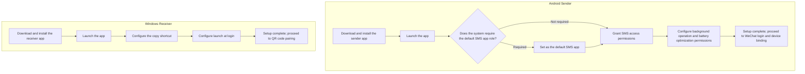
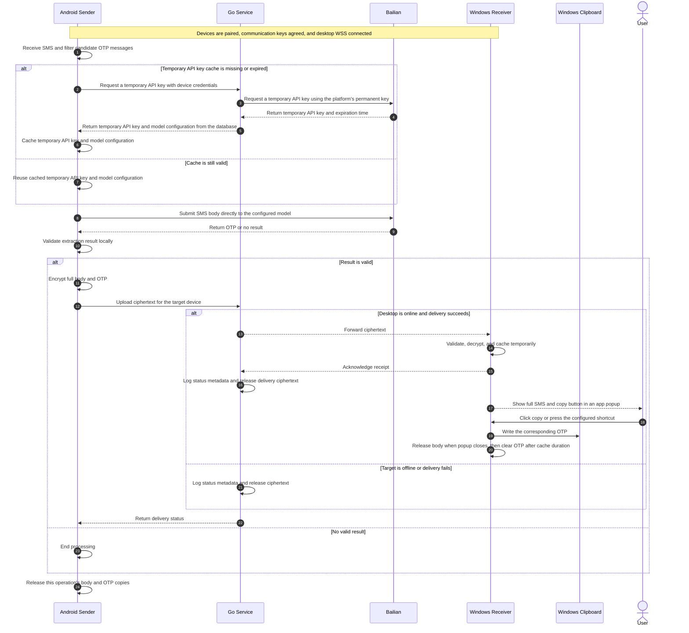
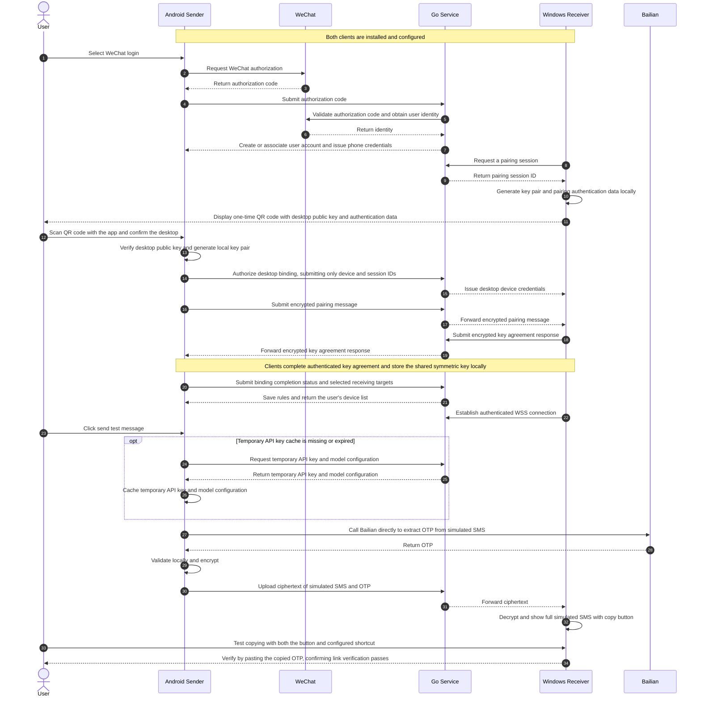

# PinGlide Technical Overview

## Goals

PinGlide forwards SMS verification codes from Android to Windows. Android receives candidate OTP SMS messages, calls Alibaba Cloud Model Studio (Bailian) directly to extract the OTP, and encrypts the full SMS body and OTP for forwarding through the service to Windows. The receiver decrypts the message and displays an app notification popup with a “Copy OTP” button and a configurable global shortcut.

The phone and desktop communicate over the public internet. With normal network conditions, all required phone permissions granted, and the desktop online, the target time from SMS arrival to the desktop popup is **within 5 seconds**, subject to end-to-end measurement.

## Repositories and Responsibilities

See the [technology stack overview](pin-glide-tech-stack-overview.md) for technology choices, build, testing, and deployment.

| Repository | Responsibilities |
| --- | --- |
| `pin-glide-android` | WeChat login, device and rule management, key agreement, initial SMS filtering, temporary API key caching, direct Bailian extraction, result validation, and encrypted uploads |
| `pin-glide-service` | WeChat login validation and account association, device authorization, login credential issuance, model configuration queries, Bailian temporary API key requests, encrypted pairing message relay, and real-time ciphertext routing |
| `pin-glide-windows` | QR code pairing, key agreement, background reception and decryption, app popups, copy buttons, global shortcuts, and clipboard operations |

The Go service runs on the project's own server, using Huma for HTTP APIs, PostgreSQL for users, devices, credential digests, forwarding rules, Bailian model configuration, and processing status logs, and Jet for database access. The service coordinates live WSS connections in memory. Docker images and psqldef schema deployment follow the deployment-tool workflow of [helm-gateway](https://github.com/BuddyLabsCo/helm-gateway). A future static product homepage belongs to `pin-glide-service` and is hosted on the project's own server.

## Identity and Device Binding

- Android signs in through the WeChat SDK. The service validates the authorization code, verifies the WeChat identity, and creates or associates a user account. WeChat integration uses an approved mobile application.
- Windows requests a pairing session and displays a one-time QR code; the user scans it with the authenticated Android app and confirms the desktop. One session lives five minutes, is created in exactly one of the adopted modes (`new_receiver`, `add_sender`, `recover_receiver`) and its mode and target Receiver are fixed at creation, so no later request can switch them.
- The QR is UTF-8 JSON carrying `version`, `cryptoVersion`, `sessionId`, `receiverId`, the desktop's fresh P-256 recipient public key and its fresh 32-byte QR PSK. It carries no credential and no service URL: clients use their configured origin and check the session metadata against the QR references.
- Pairing follows the exact v1 profile in [section 5 of the service specification](../specs/service-requirements.md#5-cryptographic-profile-v1): HPKE PSK mode `0x01` with P-256/HKDF-SHA256/AES-256-GCM, 65-byte uncompressed public points, ASCII `pin-glide/pairing/v1` info, the session ID as PSK ID and empty HPKE AAD. Both clients export the 32-byte Pairing key under ASCII `pin-glide/message-key/v1`, then exchange AES-256-GCM key confirmations that authenticate the typed role, the peer challenge and the handshake state.
- The service relays opaque handshake bytes between the session's two authenticated participants and never sees a key or verifies client key material. Each side reports key confirmation with its own credential, and the Pairing activates only after both authenticated reports: a `new_receiver` session then offers the first Receiver credential, while an `add_sender` session completes without issuing one. The restricted channel keeps no history, so a reconnect receives the current session state and nothing sent before it.
- Each phone-desktop pair keeps its own communication key. Reinstalling a client requires a new pairing, and re-pairing reserves a new Pairing ID next to the working association: only that Sender's association is retired, and only once both clients report the new key confirmation. Failure, cancellation or expiry before that commit preserves the working association, and a concurrent replacement whose association already changed is superseded. A Sender's own alias carries over to the replacement unless the confirming request supplies another one.
- The service issues separate credentials rather than one token per device: a management credential manages the Sender's own associations, an upload credential submits ciphertext and requests temporary API keys, a renewal credential rotates that Sender's bundle, the Receiver credential holds the Receiver's one delivery connection, and the restricted pairing credential opens one Pairing Session. [Section 3](../specs/service-requirements.md#3-credential-types) states their holders and lifetimes, and [section 9](../specs/service-requirements.md#9-wire-conventions-and-operation-inventory) states the operations each one authorizes.
- A fresh WeChat login registers an installation or restores its saved `deviceId`, and a restore atomically replaces that Sender's M/U/F family while its Pairings and local keys survive: a delayed old family can neither renew nor revoke the family that replaced it, and only the Account that owns an active registration may restore it. An unknown or foreign `deviceId` is `404 resource_not_found`; one an Account owner permanently revoked is refused with `409 device_registration_revoked` and never recreated, so that installation signs in again without the old ID.
- Logging out revokes the Sender's whole family and keeps its Pairings, so the same installation can log in again; switching accounts additionally removes that Sender's own associations and cancels its unfinished reserved pairing work in one commit, which is why only the management credential may request it. Both end this installation's service access, and the client stops forwarding locally at once instead of claiming a remote sign-out it never received. Clearing the old local identity and pairing keys is the client's own step of the switch, so the installation requests a new registration rather than restoring the switched one.
- `POST /v1/devices/{id}/revoke` is the Account owner's permanent security action for an installation it no longer trusts: the caller's management credential plus fresh WeChat proof of the caller's own Account closes one registration that Account owns, invalidating all of its credentials, canceling its unfinished reserved pairing work and removing only its own associations in one commit. The Receiver credential, its shared delivery connection and every other Sender's association survive, and the closed `deviceId` stays refused.
- A Sender sees only its own active associations, each stating the Receiver, the Pairing ID both clients stored the key under, its own alias and the Receiver's presence (`online`/`offline`) with the time that state last changed. Renaming or removing an association touches only that Sender's own association: the Receiver credential, its shared delivery connection and every other Sender's association keep working, and the Receiver is told about a removal with `pairing_removed` on the delivery connection it already holds.
- Unfinished work never outlives the association it was forming: removing an association cancels that Sender's pending pairing work for the same Receiver, so a later key-confirmation report cannot recreate the association the user removed. Receiver credential recovery is the separate owner-approved flow of [section 4](../specs/service-requirements.md#4-pairing-and-receiver-credential-acquisition), which interrupts the shared connection for all of that Receiver's Senders and preserves only the Pairings whose local keys survived; losing a client key instead requires a new pairing.

## Model Extraction and Temporary API Keys

- The model adapter runs on the sender and supports only Bailian. PostgreSQL defines the model in use, and the service provides its current configuration to the sender.
- The platform's permanent Bailian API key is stored in protected server-side configuration supplied through the deployment tool and authorized for the required models. After authenticating the device, the service requests a temporary API key from Bailian and returns it with the model configuration and key expiration time.
- Android caches the temporary API key and its model configuration. It reuses a valid cache and requests a new key from the service when the cache is missing or expired.
- Android calls Bailian directly over HTTPS in non-thinking mode to obtain a concise structured result, then validates the OTP against the original text locally.
- SMS plaintext is processed only by the sender, Bailian inference service, and receiver. The service handles credential requests, configuration, routing metadata, and ciphertext. Huma exposes HTTP APIs; model inference remains on Android through direct Bailian calls. Device encryption keys remain exclusively on the clients.

## Encryption, Delivery, and Display

- Android configures “sender phone → target desktop” rules, which are stored in PostgreSQL. The server selects recipients using authenticated device identities and forwarding rules.
- The sender uses established authenticated encryption to encrypt the full body and OTP separately for each target device using that pair's communication key. Message identifiers support deduplication, receipt acknowledgments, and replay protection.
- Uploads are event-driven. On systems requiring the default SMS app role, the sender fulfills that role's responsibilities.
- Windows runs a native background application in the user session, maintains a WSS connection, validates messages, and decrypts them. The app popup shows the full SMS body. Its button copies that message's OTP; the shortcut copies the latest cached OTP.
- The server holds message ciphertext temporarily in memory. It releases ciphertext after successful delivery, failure, an offline target, or request rejection. PostgreSQL processing-status records and application logs store only message identifiers, devices, timestamps, and status. Reconnected clients receive only new messages.
- The sender releases its processing copies of the body and OTP when processing finishes. The receiver releases the body when the popup closes. It caches the OTP only in memory and clears it after the locally configured cache duration.
- Core business logic is separate from HTTP/WSS transport and PostgreSQL integration. Protocols are defined in `pin-glide-service`; clients depend on those contracts rather than the backend's implementation or deployment details.

## Client Installation Flow

## Sequence: SMS Arrival to Copying the OTP

## Sequence: Server Processing

## Sequence: Login, Device Binding, and Link Verification

The sender app generates a test message and processes it through the normal Bailian extraction, end-to-end encryption, and delivery flow. The test verifies the desktop popup, copy button, and shortcut.

