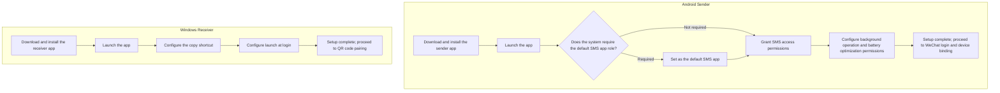
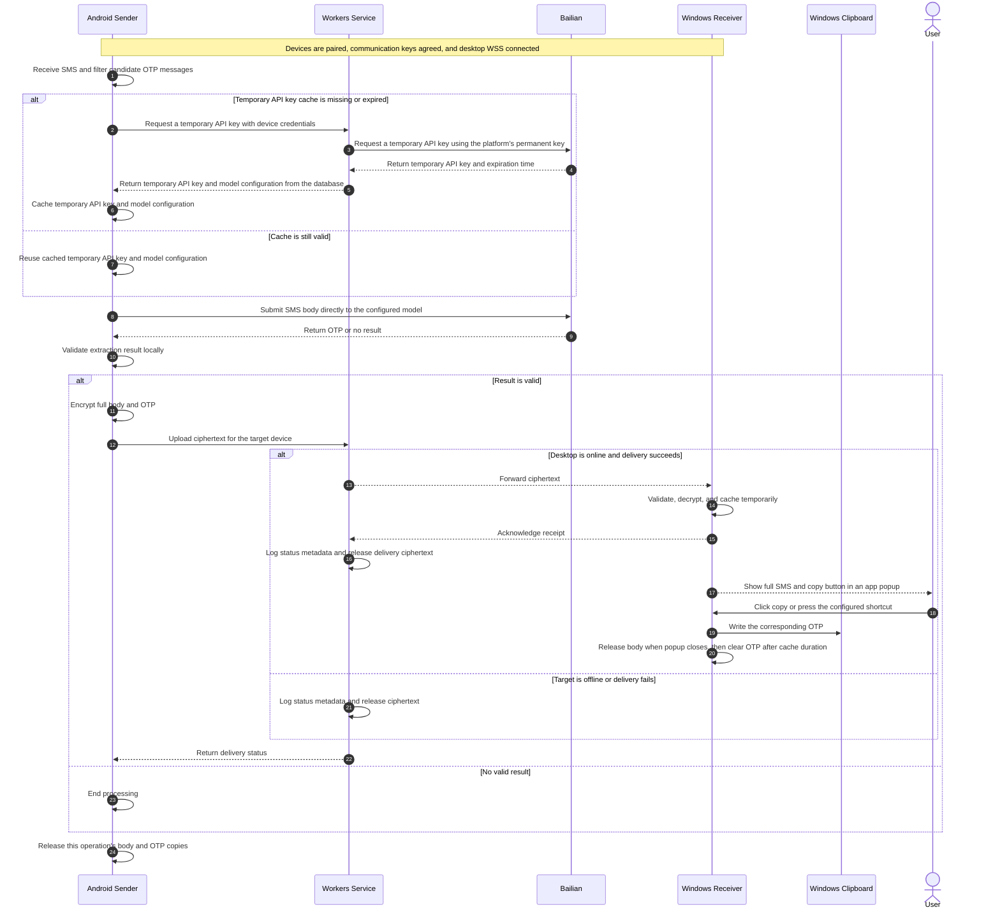
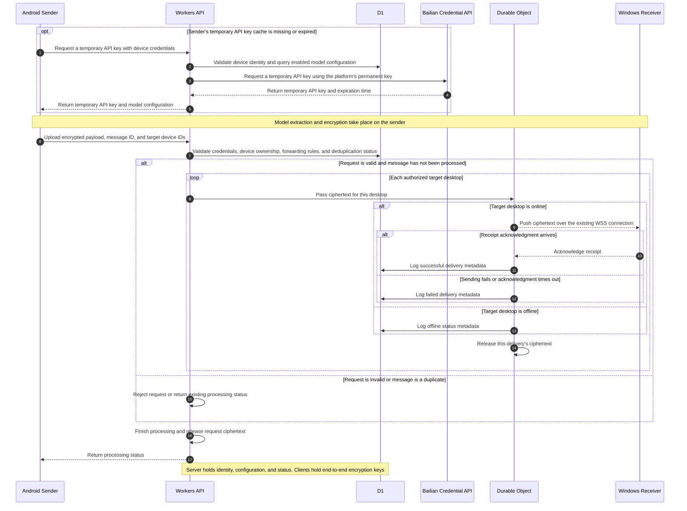
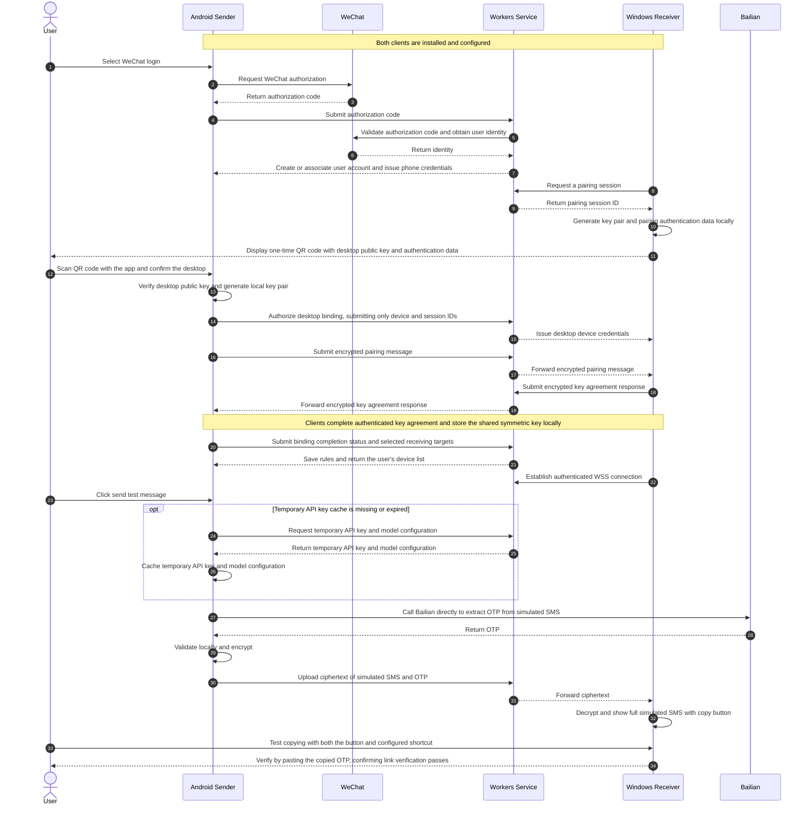

# PinGlide Technical Overview

## Goals

PinGlide forwards SMS verification codes from Android to Windows. Android receives candidate OTP SMS messages, calls Alibaba Cloud Model Studio (Bailian) directly to extract the OTP, and encrypts the full SMS body and OTP for cloud forwarding to Windows. The receiver decrypts the message and displays an app notification popup with a “Copy OTP” button and a configurable global shortcut.

The phone and desktop communicate over the public internet. With normal network conditions, all required phone permissions granted, and the desktop online, the target time from SMS arrival to the desktop popup is **within 5 seconds**, subject to end-to-end measurement.

## Repositories and Responsibilities

See the [technology stack overview](pin-glide-tech-stack-overview.md) for technology choices, build, testing, and deployment.

| Repository | Responsibilities |
| --- | --- |
| `pin-glide-android` | WeChat login, device and rule management, key agreement, initial SMS filtering, temporary API key caching, direct Bailian extraction, result validation, and encrypted uploads |
| `pin-glide-service` | WeChat login validation and account association, device authorization, login credential issuance, model configuration queries, Bailian temporary API key requests, encrypted pairing message relay, and real-time ciphertext routing |
| `pin-glide-windows` | QR code pairing, key agreement, background reception and decryption, app popups, copy buttons, global shortcuts, and clipboard operations |

Cloudflare infrastructure uses free plans. D1 stores users, devices, credential digests, forwarding rules, Bailian model configuration, and processing status logs. Durable Objects coordinate real-time connections. A future static product homepage belongs to `pin-glide-service`.

## Identity and Device Binding

- Android signs in through the WeChat SDK. Workers validate the authorization code, verify the WeChat identity, and create or associate a user account. WeChat integration uses an approved mobile application.
- Windows requests a pairing session and displays a one-time QR code. The user scans it with the authenticated Android app and confirms the desktop and receiving relationship.
- During initial device binding, each client generates an asymmetric key pair locally. They agree on a shared symmetric key through an encrypted pairing channel authenticated by the QR scan. Public keys, private keys, and shared keys remain in secure local storage on the clients.
- The desktop QR code contains its local public key and locally generated pairing authentication data. Workers relay key agreement messages as ciphertext. Binding results sent to the server contain only device identifiers and authorization status.
- Each phone-desktop pair establishes its own communication key. Reinstalling a client or replacing a key requires pairing again by QR code.
- The server automatically issues separate login and device credentials for each client. The phone user session manages the user's devices and rules. Upload credentials submit ciphertext and request temporary API keys; receiving credentials subscribe to ciphertext assigned to that receiver.
- Android lists the user's paired desktops and their online status, with options to rename, remove, and revoke authorization. Revocation closes the corresponding connection and removes the desktop from forwarding rules.

## Model Extraction and Temporary API Keys

- The model adapter runs on the sender and supports only Bailian. D1 defines the model in use, and Workers provide its current configuration to the sender.
- The platform's permanent Bailian API key is stored as a Workers Secret and authorized for the required models. After authenticating the device, Workers request a temporary API key from Bailian and return it with the model configuration and key expiration time.
- Android caches the temporary API key and its model configuration. It reuses a valid cache and requests a new key from Workers when the cache is missing or expired.
- Android calls Bailian directly over HTTPS in non-thinking mode to obtain a concise structured result, then validates the OTP against the original text locally.
- SMS plaintext is processed only by the sender, Bailian inference service, and receiver. Workers handle credential requests, configuration, routing metadata, and ciphertext. Device encryption keys remain exclusively on the clients.

## Encryption, Delivery, and Display

- Android configures “sender phone → target desktop” rules, which are stored in D1. The server selects recipients using authenticated device identities and forwarding rules.
- The sender uses established authenticated encryption to encrypt the full body and OTP separately for each target device using that pair's communication key. Message identifiers support deduplication, receipt acknowledgments, and replay protection.
- Uploads are event-driven. On systems requiring the default SMS app role, the sender fulfills that role's responsibilities.
- Windows runs a native background application in the user session, maintains a WSS connection, validates messages, and decrypts them. The app popup shows the full SMS body. Its button copies that message's OTP; the shortcut copies the latest cached OTP.
- The server holds message ciphertext temporarily in memory. It releases ciphertext after successful delivery, failure, an offline target, or request rejection. D1 and application logs store only message identifiers, devices, timestamps, and status. Reconnected clients receive only new messages.
- The sender releases its processing copies of the body and OTP when processing finishes. The receiver releases the body when the popup closes. It caches the OTP only in memory and clears it after the locally configured cache duration.
- Core business logic and platform integration are separate layers. Protocols are defined in `pin-glide-service`. The backend can later be replaced with Node.js, SQLite, and a conventional WebSocket service.

## Client Installation Flow

## Sequence: SMS Arrival to Copying the OTP

## Sequence: Server Processing

## Sequence: Login, Device Binding, and Link Verification

The sender app generates a test message and processes it through the normal Bailian extraction, end-to-end encryption, and delivery flow. The test verifies the desktop popup, copy button, and shortcut.

